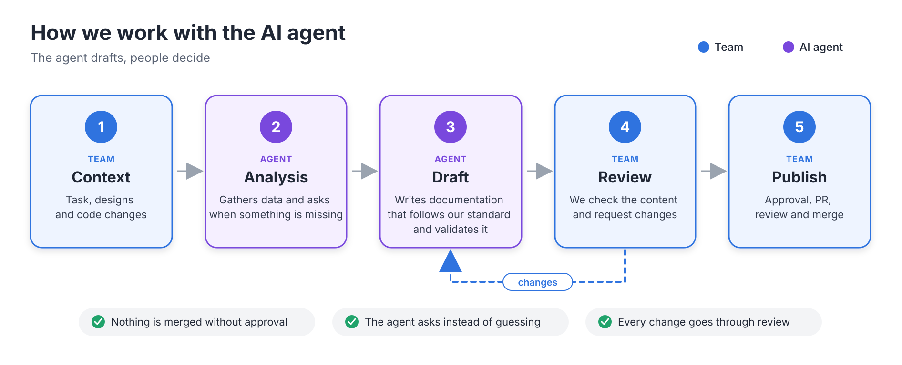

Good documentation helps engineers understand how a system works and why it
was built that way. In our product area, documentation was hard to find and
hard to keep current: information was scattered across many tools, pages fell
behind when the product changed quickly, and some knowledge lived only in the
heads of a few people.

Our team at [Allegro](https://allegro.tech) wanted an AI agent to keep the
documentation current. Spoiler: an agent does not do this well out of the box.
It started to work well only after we gave the documentation a structure: a
standardized feature page for each feature (a main page with a few subpages in
one folder), kept in a dedicated documentation repository, with standards for
maintaining the pages and validators that check them automatically. Only then
did we create an agent that writes and updates the feature pages. It bases them
on a project document (the Project Brief) and on other sources, such as Figma
mockups, Jira tasks, accessibility and security test reports, and pull requests
and code from our other repositories.
We also automated adding documentation for new features, and the agent now does
this very well. This post describes that work and what we learned from it.

## How we organized the documentation

### Problem: documentation scattered, quickly outdated, and dependent on people

In the product area we worked on, project information such as requirements,
decisions, and specifications was spread across design documents, issue
trackers, source code, pull requests, and conversations. The information was
not missing; it was scattered, so every question about a feature turned into a
small treasure hunt. Features were documented in different ways, with
inconsistent structures, naming, and links to related pages and to their
sources (requirements, contracts, code, and tests).

The product also changed quickly, so whatever was written down became outdated.
And the knowledge of how a feature should work often sat with a few people.
When someone with deep domain knowledge left the team, or when we returned to a
feature after months, we had to reconstruct how it was supposed to work.

### Goal: one standard entry point for each feature

We wanted every feature to have a single, standardized entry point: a page
that describes only the most important aspects of the feature and the
reasoning behind them (for example, why we chose a given solution) and, where
more detail is needed, links to the detailed materials. The materials
themselves stay in the systems where they already live: the feature pages link
to them instead of copying them, so nothing has to be maintained in two places.
Such documentation should also help other teams contribute to our features and
take inspiration from our technical solutions.

### Solution in outline

The solution has three parts: an input written by people, an AI agent that
turns it, together with the code, into documentation, and the resulting
documentation, which people review before it is accepted.

- **Input: the Project Brief (written by people).** For each project we keep
  one document in Google Docs. It summarizes the intended behavior, guidelines,
  and key decisions, and links to the context scattered across tools such as
  Jira tasks, notes from grooming sessions and other scattered documents, Figma
  mockups, and accessibility, research, and security test reports. Where
  needed, we also copy key details into it, for example an API contract from
  the code, which rarely changes. Once the feature is released, the brief is
  frozen in that state. When we change the feature later, we create a new
  brief for the change, and the agent updates the feature page based on it.
  The brief records the intended architecture, but not implementation
  details; those come from pull requests and code in the separate code
  repositories.
- **Engine: the AI agent and human review.** The agent creates new feature
  pages and updates existing ones, following the documentation guidelines
  stored in the documentation repository. It bases them on the Project Brief
  and reads the other sources listed above directly, along with pull requests
  and code from the code repositories. Engineers review every draft and trace
  its claims to the source before it is accepted. People can also write or
  edit pages by hand; such pages follow the same structure and checks.
- **Output: feature pages (generated by the agent, reviewed by people).** A
  feature page is the documentation of one feature: a main page and a few
  subpages in one folder, laid out the same way for every feature. The main
  page gives the overview, business requirements, confirmed decisions, and the
  reasoning behind them. The subpages describe the API contract,
  accessibility, test notes, and the technical details of each platform (the
  technical pages). Every page contains only the most important aspects and
  links to the detailed sources (Jira tasks, Figma designs, pull requests,
  code, and tests) instead of duplicating them. Each feature page has a named
  owner. We created a separate Git repository that holds only the maintained
  feature pages, with shared naming rules for pages and their assets. Links
  between pages stay within this repository; links to requirements,
  contracts, code, and tests point to the systems where they live, and we did
  not rename or move anything there.

We did not rework older documentation in one large pass. Feature by feature,
the agent either created a feature page from scratch or updated an existing
page to meet the new standards, checking its claims against current code and
tests. Material that could not be verified was not carried over as current
fact. The section about older features below describes this process in more
detail.

Throughout this post, approved sources are the sources the
team treats as authoritative for a given kind of fact. The Project Brief and
approved designs show what was intended; code and tests show what is
implemented. Jira tickets are only context: they record what the team planned
to do, not what was done.

## The Project Brief: where the agent finds intended behavior

The agent does not guess what a feature was supposed to do. It reads the
Project Brief, a per-project document in Google Docs that records the intended
behavior and the decisions behind it. Every Project Brief follows the same
template, with sections such as owners, business goal, acceptance criteria,
rollout and security status, mockups and accessibility, technical architecture,
analytics, and QA scenarios. The brief shows what was intended; the code and
tests show what is actually implemented. A short excerpt:

> Business goal: Let invited groups plan a trip on one shared map instead of in
> scattered tools.
>
> Acceptance criterion: Changes to the plan appear to other participants
> within two seconds.
>
> Mockups: Final mockups are pending product-owner approval.

The excerpt comes from an illustrative example project, a collaborative travel
planner in a fictional Wędrownik App. A
[full example](#give-the-agent-a-verified-brief-and-source-links) follows later
in this post.

## Put the rules in files the team can reuse

We started with the technical pages of a feature, where the agent could compare
a pull-request diff in a code repository with the changed code and tests. Other
kinds of pages, such as the business overview or the API description, need
different sources and review criteria, so each kind has its own task-specific
instructions. In our setup, one documentation skill covers all of them: its
short `SKILL.md` holds the non-negotiable rules and tells the agent which
reference file to load for the current task. This post shows only the technical
part. For it, we wrote a small **Markdown Starter Kit** with three kinds of
guidance:

- [`documentation-standard.md`](/assets/img/articles/2026-11-16-hire-a-cyber-scribe-as-an-intern-how-we-automated-documentation-writing/documentation-standard.txt)
   sets the rules shared by all documentation: ownership, evidence rules (what
   counts as proof of implemented and of intended behavior, and what to do when
   sources conflict), the structure of a feature's technical page, and security
   and review rules.
- [`skills/draft-technical-page/SKILL.md`](/assets/img/articles/2026-11-16-hire-a-cyber-scribe-as-an-intern-how-we-automated-documentation-writing/draft-technical-page-skill.txt)
   tells the agent what to do when documenting the technical pages of one
   feature: analyze the code changes and generate a first, working version of
   the page (a draft), together with a list of points that a human must verify.
   It also lists the inputs the agent needs (feature, pull request, the feature
   page to update, approved sources, owner); if one is missing, the agent asks
   instead of guessing.
- [`references/project-brief-template.md`](/assets/img/articles/2026-11-16-hire-a-cyber-scribe-as-an-intern-how-we-automated-documentation-writing/project-brief-template.txt) is the template of the Project Brief
   described above. Thanks to it, the agent finds the same kind of information
   in the same place in every project.

The files live in this structure:

```text
docs/
   documentation-standard.md
   references/
      project-brief-template.md
   skills/
      draft-technical-page/
         SKILL.md
```

In a larger setup, the same skill points to further reference files, for
example one for business documentation and one for screenshots and other media.
The agent loads them only when the task needs them. The starter kit keeps just
the technical workflow.

The linked files are starting points. Replace their examples with your
repository's conventions. The full example of a filled-in Project Brief follows
in the next section.

## Give the agent a verified brief and source links

Before drafting, give the agent two inputs:

- The Project Brief (the project document in Google Docs described
   above) for the relevant project or product area. It records confirmed goals,
   decisions, owners, and open questions.
- A documentation request: the task we give the agent. It names the feature,
   intended reader, the feature page to create or update, code revision, and
   links to relevant source artifacts.

In this example, the Wędrownik App has one Project Brief that is reused across
documentation requests for its features; it is not recreated for each feature
page. Each request links only the relevant brief sections and adds evidence
specific to the change. Projects with separate ownership and decisions can
maintain separate briefs.

For technical content, also link to the pull request diff, changed code, and
tests at the same revision, and include an approved design frame when relevant.
The agent then returns one source-linked draft for review. For example:

```text
Project Brief: <link and relevant sections>
Feature: invitation-based collaborative trip planning
Reader: engineers
Destination: docs/features/collaborative-travel-planner.md
Revision: <pull request URL and commit SHA>
Implementation evidence: pull request diff, changed files, and tests
Approved design: <specific Figma frame, if relevant>
Known open decision: final mockups are pending approval
Output: one feature page; do not edit other files
```

Replace each placeholder with an accessible source before running the skill.

The example below shows how the Project Brief can hold that product context.
Its project details, metrics, and identifiers are illustrative, not production
data. A
plain-text copy is [available to download](
   /assets/img/articles/2026-11-16-hire-a-cyber-scribe-as-an-intern-how-we-automated-documentation-writing/collaborative-travel-planner-example.txt).

**Project Brief: Collaborative Travel Planner (Wędrownik App)**

**1. General Information**

| Role / Team | Name / Details |
| --- | --- |
| Product Owner (PO) | Name |
| Tech Lead | Name |
| QA Lead | Name |
| UX Designer | Name |
| Analyst | Name |
| Slack Channel | #proj-collab-planner |
| Epic Link (Jira) | TRV-XXXX |
| Deployment Date (Deadline) | November 15, 2026 (Flexible) |
| Collaborating Teams | Core Web, Maps, Backend API |

**2. Business Goal**

| Section | Content |
| --- | --- |
| Business goal | The “Collaborative Travel Planner” project aims to allow groups of users to simultaneously and collaboratively plan trips in our web application. This solves the problem of scattered communication and the need to use external tools like spreadsheets. This functionality will increase user engagement, facilitate collaboration when choosing destinations, and increase the chances of group conversion (shared bookings for hotels and attractions). |

**3. Acceptance Criteria**

| # | Criterion |
| --- | --- |
| 1 | Every user with a generated invitation link and appropriate permissions can add and remove points of interest (POI) on the map. |
| 2 | Any modifications to the plan list must be reflected for other users in real time with a delay of no more than 2 seconds. |
| 3 | Built-in voting mechanism (thumbs up/down) for accommodation and trip proposals. |
| 4 | The list and map views must be fully responsive, adapted for mobile devices (PWA). |

**4. Project Phases, Deployment & Legal/Security**

| Topic | Content |
| --- | --- |
| Deployment method | Deployed under the `ff_collaborative_planner_enabled` Feature Flag. Flag management is handled on the backend (using a tool like LaunchDarkly). |
| A/B testing and experiments | Yes, A/B tests are initially planned for 10% of users. The success criterion is a 15% increase in the engagement rate compared to the control group. |
| Legal & Security | Completed. The legal team approved the privacy policy regarding the shared links mechanism. |

**5. Mockups and Accessibility (UI/UX & a11y)**

| Topic | Content |
| --- | --- |
| Figma Link | No final external URL yet (draft version pending approval). |
| Contrast | Provided standard-compliant contrast (minimum 4.5:1) for add and vote buttons. |
| Screen readers | Set descriptions for Screen Readers — e.g., `aria-label`s informing about new elements added to the plan. |
| Enlarged fonts | Included support for enlarged fonts without losing UI readability. |

**6. Technical Details and Architecture**

| Topic | Content |
| --- | --- |
| Synchronization | Asynchronous synchronization based on WebSockets with a fallback to Server-Sent Events (SSE) was applied. |
| Backend / API contract | `POST /api/v1/trips/{tripId}/points`. Endpoint adding a new point to the shared plan. Emits an event to other users in the session. |
| React/Vue components | `CollaborativeMapContainer`, `LiveUserCursors`, `PlannerSidebar`. |
| State management | Use of Redux (or Context API) coupled with Socket.io for optimistic UI rendering of newly added points. |

Request body:

```json
{
   "pointId": "uuid-1234-5678",
   "type": "ATTRACTION",
   "location": { "lat": 52.2297, "lon": 21.0122 },
   "name": "National Museum",
   "addedBy": "user-789"
}
```

**7. Analytics**

| Event Name | Category | Action | Label | Custom Parameters |
| --- | --- | --- | --- | --- |
| `CollabPlanner_Opened` | Screen | View | PlannerTab | `tripId`, `isOwner` |
| `POI_Added` | Interaction | Add | MapMarker | `poiType`, `lat`, `lon`, `tripId` |

**8. Quality Assurance & Testing**

| Topic | Content |
| --- | --- |
| Test data | Prepared accounts: `test_owner_01` (plan creator) and `test_guest_01` (participant from link). |
| Happy path | User A opens the travel plan, generates an invitation link. User B enters via the link and adds a new hotel. User A sees the new point with a delay of up to 2 seconds. |
| Corner case | Testing connection loss during editing — upon network resume, changes must be synchronized (Conflict Resolution). |

**9. Definition of Ready (DoR) Checklist**

| Status | Checklist item |
| --- | --- |
| [x] | Tech Lead and QA Lead are selected and assigned to the parent epic |
| [x] | Project channel created on Slack |
| [x] | Business goal is documented in the parent epic |
| [x] | Acceptance criteria are written down in the epic and tasks |
| [x] | The project has a designated deployment date |
| [x] | The release method is determined |
| [ ] | Mockups are completed and approved (requires PO approval) |
| [x] | Backend contract is frozen |

The brief was not itself the documentation standard: the standard said what
each field meant, who maintained it, and what the agent had to do when a value
was missing or stale.

We treated the brief as a maintained source of project context, not as extra
background to paste into every prompt. We kept ownership and status visible,
linked to the approved source of truth, and updated the brief when decisions
changed until the feature was released. An unfilled template or outdated
document was not a useful knowledge base; when important fields conflicted or
were marked as not started, the agent surfaced the gap instead of turning it
into a requirement.

We also learned that a PDF export of the brief was not a reliable source by
itself. Tables, page breaks, and diagrams were sometimes scrambled during text
extraction, so we kept a structured Markdown version and checked extracted text
before treating it as authoritative. We kept passwords, tokens, and real user
credentials out of the brief, using access-controlled references for sensitive
test data.

### From project brief to a reviewable draft

The following case study uses the illustrative Wędrownik App brief above to
show how individual pieces of information move through the workflow: from an
entry in the brief, to an agent-generated draft, to a reviewer’s verification
or follow-up action. An action item is not a generic chore: it names a claim
that the available evidence cannot fully verify and tells the reviewer what to
confirm before accepting the draft. The examples show how the agent uses
supplied information, not how it invents missing details.

**Business goal and acceptance criterion**

Brief:

> Goal: Let invited groups plan a trip on one shared map instead of in
> scattered tools.
>
> Acceptance criterion: Changes to the plan appear to other participants
> within two seconds.

Possible documentation draft:

> Invited participants can collaborate on a shared trip plan. When one
> participant changes the plan, the update appears to the others within two
> seconds.

Reviewer action item:

> Ask the QA owner which edits the two-second target covers. Compare that scope
> with the relevant tests and monitoring before documenting it as a guarantee.

The brief supplied a measurable expectation, but the reviewer still had to
check its scope and verify that the implementation matched it.

**Technical architecture**

The brief named WebSockets and Server-Sent Events, described the web components,
and linked to a frozen API contract. It also left the final mockups pending
approval. The agent could explain the confirmed synchronization approach, but
should not invent endpoint details or describe a draft design as final. Each
technical statement still needed a traceable source.

**QA preparation**

The brief provided a collaboration scenario and a network-recovery edge case.
The agent could turn those into draft checks; QA still had to confirm conflict
resolution behavior and test feasibility. Account names and other sensitive
fixtures stayed in access-controlled systems, not in public articles or
generated documentation.

**An unfinished decision**

Brief:

> Final mockups: Pending product-owner approval.

Possible documentation draft:

> The final mockups have not yet been approved. The current draft should not be
> treated as the authoritative design.

Reviewer action item:

> Confirm who approves the mockups and link the approved design before treating
> visual details as final.

### Avoid unsupported claims

For code-related documentation, we used the pull request diff as the boundary of
what changed in that contribution. Full files helped explain those changes, but
we did not let them make the agent attribute existing behavior to new work.
When it could not tell whether a detail was new, unchanged, or outside the task,
it left the claim out or asked.

That distinction mattered because language models were good at turning
fragments into plausible explanations. Plausibility was not evidence. An
invented class, an inferred product rule, or behavior copied from neighboring
code could look perfectly reasonable in a polished paragraph. We made it easier
for the agent to say “I don’t know” than to fill in a gap.

### Documenting older features

Old documentation does not have to be carried over in full before this
workflow can help. Teams can use the standard and the agent for new features as
they are developed, and gradually create or update feature pages for older
features. Carry information over only when it is still useful and can be
verified.

For older features, we did not ask the agent to document the whole product at
once. We started with one feature or user journey that had a clear owner and a
real maintenance need. We listed likely sources — current code and tests,
recent changes, issue trackers, old documents, and conversations with people
who knew the system — then recorded which source was authoritative for each
kind of fact. A ticket explained why a change had been requested; current code
and tests showed what it did at the time. Neither source alone told the whole
story.

Teams can treat the remaining cleanup as documentation debt: schedule a
feature-sized slice in upcoming sprints, or group a larger cleanup into an
epic. An agent can help inventory old documents, trace claims to sources, and
draft updates; maintainers still prioritize the work, resolve conflicts, and
approve the result.

We had the agent create a claim inventory — a Markdown table with one row per
important statement in the draft — rather than silently merging contradictions
into a confident narrative. Each row linked the claim to its evidence, marked
it as verified, historical, or unresolved, and listed a follow-up when needed.
For the travel-planner example, two rows might look like this:

| Draft claim | Evidence | Status | Reviewer action |
| --- | --- | --- | --- |
| Invited users can add a point of interest | API contract and current test | Verified | None |
| All plan edits reach other users within two seconds | Brief, acceptance criterion 2; no test or metric linked | Unresolved | Ask the QA owner to define the edits covered and link evidence |

The inventory travels with the draft and its source links, so a reviewer can
see which statements are supported and which need follow-up. We chose the
highest-value missing feature page first, reviewed it with someone who
maintained that area, and used what the review uncovered to improve the
standard. That gave us a current, owned set of feature pages incrementally
without assuming that every old ticket or document was still correct.

## How we put the documentation workflow together

A documentation command became the entry point to a repeatable workflow, not a
magic prompt. Think of it as an assignment for a new intern: load the shared
rules from the documentation repository and the instructions for the specific
document type, then work through a bounded sequence:

<figure>
   
   <figcaption>
      The agent moved from task clarification and evidence collection to a reviewable draft.
      Diagram prepared with AI assistance.
   </figcaption>
</figure>

1. **We clarified the task.** We confirmed the feature, the feature page to
   update, and the source material. When a name, location, design reference, or
   pull request was missing, the agent asked instead of inferring it.
2. **We collected evidence.** For technical content, the agent read the pull
   request metadata and diff from the source repository, then inspected the full
   changed files at the same revision. The diff bounded what had changed; the
   files provided context.
3. **We separated facts from context.** We tracked which observations came
   from the change, which were already present, and which were uncertain. The
   agent omitted claims it could not tie to a source or asked about them.
4. **We drafted only the requested page.** The agent applied the relevant
   template, wrote the page in the documentation repository, and linked to
   related pages and source repositories instead of copying everything it found
   into one place.
5. **We validated and handed the draft back.** We ran Markdown and
   repository-specific checks, then returned the changed files, diff, evidence,
   and reviewer action items for claims needing confirmation. Changes stayed
   local and uncommitted for review before anything was shared.

Read-only integrations helped the agent retrieve approved context from code,
Jira tasks, Figma mockups, the Project Brief, and accessibility recordings and
test reports. When an integration was unavailable, the agent asked the author
for the missing source instead of inventing a result.

### Figma without a desktop MCP integration

Design context was especially useful for describing user-visible behavior, but
our desktop setup did not expose an
[MCP](https://modelcontextprotocol.io/) integration for Figma Dev Mode. We
addressed that gap with a small local adapter that exposed selected
[Figma](https://www.figma.com/) content through the
[Figma REST API](https://developers.figma.com/docs/rest-api/).

The designer or author provided a link to a specific, approved frame or layer,
including its `node-id`. The adapter used that identifier to request only the
selected node and a bounded amount of its child structure, rather than
fetching an entire Figma file or canvas. The metadata request looked like this:

```bash
curl --get "https://api.figma.com/v1/files/${FILE_KEY}/nodes" \\
   --header "X-Figma-Token: ${FIGMA_PERSONAL_ACCESS_TOKEN}" \\
   --data-urlencode "ids=${NODE_ID}" \\
   --data-urlencode "depth=5"
```

The same adapter asked Figma to render that node as a PNG for review. We kept
saving the image into the documentation repository as a separate action that
required the author’s explicit approval. This kept “inspect this design” distinct
from “publish this screenshot.”

The adapter did not bypass Figma permissions. The person configuring it still
needed access to the source file and a personal access token with the
`file_content:read` scope. We kept that token in local secret configuration,
never in the repository or a prompt. This gave the agent an approved REST API
path without depending on Dev Mode access or an MCP feature in the desktop app,
while keeping the requested frame explicit and reviewable.

## What we learned about evaluating models

Our workflow did not establish that one model was best. Model quality changed
quickly, and a polished answer was not necessarily a faithful one. We treated
model choice as a small, repeatable evaluation rather than a contest judged by
writing style.

We compared candidates on representative tasks using the same source snapshot,
instructions, tools, and output template. The set covered different document
types and included a task with ambiguous or incomplete evidence.

We scored results for factual accuracy, unsupported claims, important
omissions, structure and terminology, and reviewer effort. We also recorded
latency and cost. Reviewers compared drafts with the source material — not just
with one another — and repeated tasks when results varied substantially between
runs.

We used this as a model-selection exercise, not a reason to ask several models
to write every page. We selected a model for the task based on reliability and
acceptable cost, and repeated the comparison when the model, agent instructions,
or source integrations changed. Sensitive or high-impact documentation kept a
human review gate regardless of benchmark results.

## We kept people in the loop by design

The workflow left three decisions with people:

1. **Define the documentation task.** The author set its boundaries: which
   feature and behavior to document, the intended reader, the feature page to
   update, the approved evidence sources, and what was outside the task.
2. **Review the changes, not just the prose.** Reviewers checked the diff for
   factual accuracy, omissions, unsupported claims, links, and placement.
3. **Decide what shipped.** Generated changes stayed uncommitted until a person
   accepted them. Committing, pushing, or opening a pull request required
   explicit approval.

The author remained responsible for the meaning of the documentation. The agent
gathered evidence and drafted explanations, but it could not decide whether
they matched the team’s intent. When a product decision was ambiguous, we
returned to the people who made it instead of trying another generation.

We also kept the agent within the agreed scope and gave it only the access
required for each task; read-only access covered many research tasks. It did
not choose or publish images without an explicit, approved source.

## We automated what we could check mechanically

Some documentation rules were objective and repeatable. We used a simplified
checker to catch misplaced media, uppercase extensions, and asset names that
broke the repository convention:

```python
import re
from pathlib import Path

MEDIA_EXTENSIONS = {".png", ".jpg", ".jpeg", ".svg", ".mp4", ".pdf"}
MEDIA_DIRECTORIES = {"assets", "diagrams"}
ASSET_NAME = re.compile(r"^[a-z0-9_.-]+$")

for path in Path("docs").rglob("*"):
   if not path.is_file():
      continue

   suffix = path.suffix
   if suffix and suffix != suffix.lower():
      print(f"{path}: file extension must be lowercase")
   if "assets" in path.parent.parts and not ASSET_NAME.fullmatch(path.name):
      print(f"{path}: asset name must use lowercase letters, digits, . _ or -")
   if suffix.lower() in MEDIA_EXTENSIONS and MEDIA_DIRECTORIES.isdisjoint(path.parent.parts):
      print(f"{path}: media must live in an assets/ or diagrams/ directory")
```

We ran checks like these locally for quick feedback and applied the same rules
to documentation written by people and by the agent.

Other questions still needed judgment. Did the page explain the behavior a
reader came to understand? Was an important caveat missing? Did a screenshot
show the right state, and did we have permission to publish it? A linter could
not answer those questions; a reviewer had to.

## We connected the checks to a documentation pipeline

Once the checks had proved useful locally, we connected them to a pull request
job. It validated the structure, built the site, and uploaded the generated
report as a review artifact:

```yaml
name: Documentation checks

on:
   pull_request:
      paths:
         - "docs/**"
         - "scripts/docs/**"

jobs:
   docs:
      runs-on: ubuntu-latest
      steps:
         - uses: actions/checkout@v4
         - name: Check documentation rules
            run: python scripts/docs/check.py
         - name: Build the site
            run: bundle exec jekyll build
         - name: Upload generated report
            if: always()
            uses: actions/upload-artifact@v4
            with:
               name: documentation-report
               path: reports/documentation/**
```

The job reported its result on the pull request, but did not merge or publish
the change by itself. We kept production deployment behind an environment
approval or a separate release action. This made the feedback loop automatic
while leaving the irreversible decision explicit.

Slack notifications made the workflow visible without turning every check into
noise. We reserved them for useful events, such as a draft ready for review, a
broken link, or an agent blocked by a missing source. The notification included
the pull request, the failed check, and the owner of the next action; we kept
generated documents and sensitive project data out of broad channels.

We emitted a failure notification from a final CI step:

```yaml
         - name: Notify Slack about a failed check
            if: failure()
            uses: slackapi/slack-github-action@v2.1.1
            with:
               payload: |
                  {
                     "text": "Documentation checks failed: ${{ github.server_url }}/${{ github.repository }}/pull/${{ github.event.pull_request.number }}"
                  }
            env:
               SLACK_WEBHOOK_URL: ${{ secrets.DOCS_SLACK_WEBHOOK_URL }}
```

As the workflow matured, we added a preview link, a list of changed pages, the
evidence sources used by the agent, and a short summary of open questions. We
also tracked check duration, failure categories, and review time to improve the
process, not to set a quota for generated pages.

## Run the workflow on one feature

Use this sequence for the first implementation, then adjust the standard and
skill based on review findings:

1. Choose one feature with a clear owner and a recurring maintenance need.
2. Fill in the documentation request with the target revision and approved
   sources.
3. Run the skill with read-only access to those sources and permission to
   create or edit only the requested draft.
4. Check the draft against the diff, tests, and requirements. Resolve
   contradictions with the owner; do not ask the agent to guess.
5. Run documentation checks and inspect the complete diff. Record missing
   sources or repeated review findings in the standard or skill.
6. Let a person approve and publish the change. Keep commits, pull requests,
   and deployment outside the agent’s authority unless explicitly approved.

The useful measure is whether a maintainer can verify the page’s claims from
the linked evidence without reconstructing the investigation from scratch.

## What we learned as we improved the workflow

We started with one recurring documentation task and one representative
feature. We wrote down its sources, output structure, and the rules reviewers
expected. Then we asked the agent for a draft and noted where it needed
clarification, where it overreached, and which checks caught real mistakes.

We used those observations to improve the guidance and validators instead of
trying to automate every document type at once. We spent less time gathering
the same sources and applying page structure by hand, and more time checking
accuracy, context, and decisions.

## What challenged us most

The hardest part was not getting text from the agent. It was establishing
whether the text was supported and where the authoritative answer lived. The
same feature could be described differently in a ticket, an old page, the
current code, and a conversation with a maintainer. We had to preserve those
differences long enough for a person to resolve them instead of smoothing them
into a plausible story.

We also found that project context needed maintenance. An empty field or an old
decision did not become reliable just because it appeared in a well-structured
brief.

The biggest lesson was that automation did not remove the work of documenting a
system. It moved effort away from repeatedly assembling a first draft and
toward keeping sources current, resolving contradictions, and checking claims.
That was a useful trade: the agent accelerated the routine work, while the team
remained responsible for what the documentation said.

Like every intern, our documentation agent made mistakes along the way. We
learned from them too: each review helped us improve the instructions, the
checks, and the next draft. And who knows — maybe our intern will soon earn a
contract offer from us.
